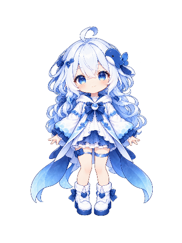
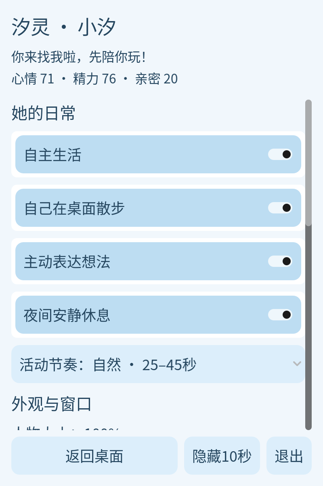

<p align="center"></p>
<h1 align="center">汐灵 XiLing</h1>
<p align="center"><strong>把一点海风，留在你的桌面。</strong></p>
<p align="center">Godot 2D 桌宠 · 小汐 · 原画与动作帧 · 自主生活与情绪</p>
<p align="center">
  <a href="https://github.com/bestows-Z/XiLing/releases"></a>
  
  <a href="https://github.com/bestows-Z/XiLing/actions/workflows/checks.yml"></a>
  <a href="https://github.com/bestows-Z/XiLing/stargazers"></a>
  <a href="https://github.com/bestows-Z/XiLing/issues"></a>
  <a href="LICENSE"></a>
  
</p>
<p align="center"><a href="#开始陪伴">开始陪伴</a> · <a href="#操作">操作</a> · <a href="#平台状态">平台状态</a> · <a href="CONTRIBUTING.md">参与贡献</a></p>

小汐是非官方原创海洋主题角色。打开项目就会显示仓库内的原始人物，不需要额外找图。原始睁眼、眨眼 PNG 保留不变；挥手、跳跃、摸摸、进食、睡觉、好奇、行走、跳舞、伸懒腰和整理头发各有独立六帧图集，共60张不同图片。

她会自己观察、散步、玩耍和休息。当前行为由本地需求评分、性格、时间、近期经历和连续活动计划决定；“想法”是这些决策的文字表达。**这是可解释的游戏行为系统，不是 LLM，也不具有人类意识。** 无账号、密钥、聊天、联网 Agent 或 Flutter 依赖。

## 实际运行预览

<p align="center">
  
  
</p>
<p align="center"></p>

截图来自 macOS 上的 Godot 实际渲染。设置使用400×600逻辑像素的独立窄长窗口和18号文字，Retina 屏幕自动补偿显示比例；缩小人物不会把设置一起缩小。设置行可滚动，底部始终保留返回、隐藏、退出。

## 她会做什么

| 系统 | 已实现内容 |
| --- | --- |
| 原画与动画 | 默认使用原始待机和眨眼 PNG；10组动作各6张不同图片，统一尺度与落脚参考，帧间短淡化，不再反复穿插原始待机图造成姿态跳变 |
| 自主生活 | 根据精力、心情、无聊、好奇心、性格和时间选择目标；观察→散步→张望、打哈欠→坐下→睡眠→苏醒、跳跃→开心等连续活动 |
| 主动移动 | 手动/自主散步均带位移，步伐按移动距离播放并同步朝向，屏幕边缘转向；悬停、设置、拖动、游戏或关闭动画时同时暂停位移与迈步。Wayland与编辑器嵌入预览禁用 |
| 情绪与想法 | 心情、精力、无聊、亲密度、好奇心均为 0–100；清醒消耗精力、休息恢复；显示当前目标的原因。无离线惩罚，不因离开扣亲密度 |
| 互动 | 轻点摸摸、双击挥手、连续点击惊讶、来回移动鼠标抚摸、喂食、拖动、右键设置；爱心和文字反馈 |
| 泡泡游戏 | 20 秒、六个目标，点击计分并补充目标，可提前结束；游戏期间桌宠不会自主移动目标区域 |
| 桌面窗口 | 透明、无边框、置顶开关、拖动、屏幕边界恢复、位置记忆、60%–150% 人物大小 |
| 设置与保存 | 独立长条设置、帧率、自主生活、散步、主动提示、夜间安静；保存设置/情绪/统计/位置，原子替换及损坏备份恢复 |
| 控制入口 | macOS / Windows 状态图标菜单；无托盘时只隐藏 10 秒并自动恢复；Wayland 使用系统窗口控制 |

主要10种动作使用各自的六帧AI辅助图集，帧内肢体、表情实际变化，使用统一尺度、落脚参考及100毫秒切帧淡化。六帧仍不是高帧率手绘动画或精细骨骼绑定。开心/害羞复用抚摸图集、苏醒复用伸懒腰，坐下等辅助状态沿用已有关键姿态；没有独立的生气和背面转身美术。不会把状态数量当作独立美术数量。

完成一次自主活动后，默认待机25–45秒；超过两分钟无人互动时延长到45–90秒。设置可选“安静 / 自然 / 活泼”，跳跃、跳舞等大动作有更长冷却，低精力主动休息是例外。同一次活动计划只显示一次想法。

程序绘制的 22 状态关节演示保留作开发和图片缺失时的容错，不在正常设置中提供该角色入口。旧版默认演示皮肤会迁回原画。角色资源和自定义 `SpriteFrames` 接口仍可替换表现来源。

## 开始陪伴

当前提供源码及未签名候选构建，没有验收完毕的稳定安装包。安装 [Godot 4.7.2 标准版](https://godotengine.org/download/)，导入 `project.godot`，按 **F5** 运行。无需 .NET。

```bash
git clone https://github.com/bestows-Z/XiLing.git
cd XiLing
godot --path .
```

macOS 没有命令行别名时可使用：

```bash
/Applications/Godot.app/Contents/MacOS/Godot --path .
```

原始人物、眨眼图和新增动作图集均已纳入仓库及公开导出预设。无需额外复制图片。素材来源与许可见 [人物素材说明](assets/pet/NOTICE.txt)。私有替换素材放在被忽略的 `assets/local/`，不要覆盖内置原图。

## 操作

| 操作 | 效果 |
| --- | --- |
| 左键轻点人物 | 等待双击判定后摸摸，有动作图、爱心与文字反馈 |
| 双击人物 | 挥手 |
| 左键按住并移动 | 超过移动阈值后拖动窗口；轻点不会启动拖动 |
| 在人物上来回移动鼠标 | 满足距离/换向阈值后抚摸，有冷却 |
| 快速连续点击 | 惊讶反馈，不扣亲密度 |
| 右键 / `M` | 打开独立互动与设置窗口 |
| `Space` | 跳跃动作帧 |
| `F` / `D` / `S` | 喂食 / 跳舞 / 睡或醒 |
| 设置里的“散步 / 伸懒腰 / 理头发” | 手动播放相应六帧动作，散步会移动窗口 |
| `B` | 开始或结束泡泡游戏 |
| `A` | 开关自主生活 |
| `Esc` | 结束玩法 / 关闭设置；无玩法或设置时打开控制入口 |
| `H` | 操作提示 |

快捷键需要桌宠获得焦点。没有音效，因此没有无效音量控件。

## 平台状态

| 环境 | 实际状态与限制 |
| --- | --- |
| macOS Apple Silicon | Godot 4.7.2 导入、解析、回归测试和 GPU 运行通过；实测原画/动作/独立设置渲染、Retina 两倍缩放补偿、人物缩小后设置尺寸不变、自主移动、越界恢复、隐藏及自动恢复。下层应用逐区域穿透与多显示器组合尚未完整验收 |
| macOS Intel | universal 导出候选可构建；未实机运行，未签名、未公证 |
| Windows x64 | 官方模板导出候选可构建；未在 Windows 实机验收透明、拖动、托盘或穿透 |
| Linux X11 x64 | Ubuntu CI 可导入、测试和导出；未在 Linux 桌面实机验收透明/穿透，受合成器与显卡驱动影响；当前没有 Linux 托盘实现 |
| Linux Wayland | 定位、置顶、轮廓穿透不保证；自主移动和隐藏按钮禁用。原生拖动按支持情况使用，建议尝试 XWayland |

提供 XWayland 的环境可尝试：

```bash
godot --display-driver x11 --path .
```

编辑器嵌入预览无法在真实桌面移动窗口，代码会停用位移；散步请通过`godot --path .`独立运行，或关闭编辑器的“Embed Game on Next Play”。参考[Godot嵌入预览说明](https://docs.godotengine.org/en/stable/tutorials/editor/game_embedding.html)。

平台 API 支持边界参考 Godot 官方 [DisplayServer](https://docs.godotengine.org/en/stable/classes/class_displayserver.html)、[Window](https://docs.godotengine.org/en/stable/classes/class_window.html)、[StatusIndicator](https://docs.godotengine.org/en/stable/classes/class_statusindicator.html)。构建成功不等于桌面交互验收通过。

图片使用当前帧 Alpha 命中和 BitMap 外轮廓；系统只能接收一个轮廓，所以发丝或肢体间的部分透明空隙仍可能拦截鼠标。泡泡、提示会扩大输入区域；拖动/设置打开期间整窗接收输入。隐藏通过停止绘制与窗外输入区域实现，无托盘时 10 秒恢复；主窗口不调用不受支持的 `hide()`。

## 开发与测试

```text
scenes/main.tscn                 Main → Pet
characters/*.tres               角色名称、素材和性格配置
scripts/pet_idle.gd              场景协调与输入连接
scripts/pet_brain.gd             需求评分、目标和活动计划
scripts/pet_locomotion.gd        帧率独立的步行目标和边界转向
scripts/sprite_strip.gd          六帧图集的固定尺度与落脚参考
scripts/pet_frame_transition.gd  短切帧过渡和旧帧输入轮廓
scripts/pet_mood.gd              情绪与精力
scripts/xiaoxi_animations.gd     原画动作图集与关键帧编排
scripts/pet_animation_controller.gd  动作播放、眨眼与漂浮
scripts/local_skin.gd            资源加载、Alpha 命中和轮廓
scripts/pet_menu.gd              独立长条设置与提示
scripts/desktop_*.gd             窗口、散步、托盘和隐藏
scripts/pet_interaction.gd       手势判断
scripts/pet_effects.gd           泡泡与爱心
scripts/pet_runtime.gd           设置、统计与角色组合
scripts/save_manager.gd          原子存储和备份恢复
tests/                          可重复运行的测试
tools/                          检查入口与仓库审计
```

```bash
python3 tools/check.py
python3 tools/repository_check.py
```

2026-10-29 本机 Godot 4.7.2 实测：动画168项、行为37项、步行11项、皮肤21项、场景38项、设置/存储/互动/玩法30项，共305项，以及22×21组关节演示姿态检查通过。完整macOS散步链路实测约3.5秒移动130像素，六帧随位移播放，暂停与边界转向通过。还从空目录加载实际导出资源包，验证默认原画和图集存在，防止只在本机源目录正常。

存档在 Godot `user://pet_state.cfg`，备份 `.bak`，不依赖账号或云端。自定义 `assets/local/skin.tres` 至少需要非空 `idle`，可增加同名行为动画，缺少动作时回退待机。私有素材不自动提交。

## 候选构建与发布

[Godot checks](https://github.com/bestows-Z/XiLing/actions/workflows/checks.yml) 在推送/PR 时检查干净源码。[Candidate builds](https://github.com/bestows-Z/XiLing/actions/workflows/candidates.yml) 手动执行，用官方 4.7.2 引擎与模板导出 Windows x64、Linux x64、macOS universal，附 `SHA256SUMS.txt`。

默认只产生 Actions artifact。明确填写 `v0.3.0-rc.N` 才创建预发行版，不自动发布稳定版。候选未经 Windows/Linux 完整桌面验收，没有苹果 Developer ID 签名、公证或 Windows 代码签名。请核对来源与校验值，遵循系统正常安全提示。

## 素材与许可

源码、场景、海浪 SVG、项目文档和已获维护者分发授权的人物美术随项目按 [MIT](LICENSE) 提供。原始人物图片内容未修改，新增动作图集为 AI 辅助生成；详见 [素材说明](assets/pet/NOTICE.txt)。汐灵与 DeepSeek 或其他厂商无关联，不使用官方品牌 Logo。

Noto Sans SC 来自 [Noto CJK](https://github.com/notofonts/noto-cjk)，保留 [SIL OFL 1.1](assets/fonts/OFL.txt) 和[来源说明](assets/fonts/NOTICE.txt)，字体不适用 MIT。提交第三方美术需提供来源和再分发许可。

[GitHub 源码](https://github.com/bestows-Z/XiLing) · [问题反馈](https://github.com/bestows-Z/XiLing/issues) · [贡献指南](CONTRIBUTING.md) · [更新记录](CHANGELOG.md) · [候选与发布](https://github.com/bestows-Z/XiLing/releases)
